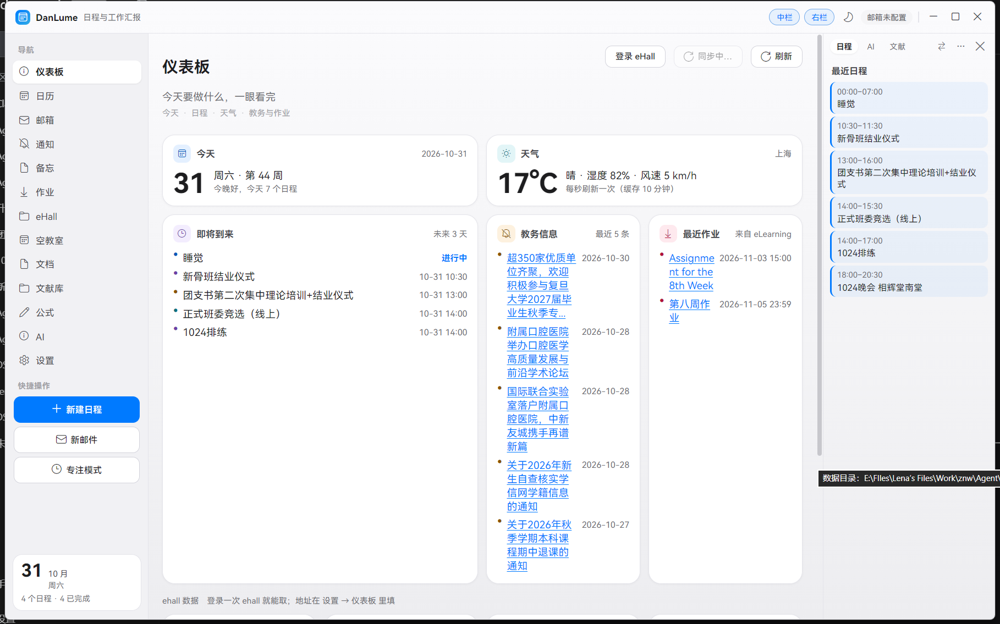
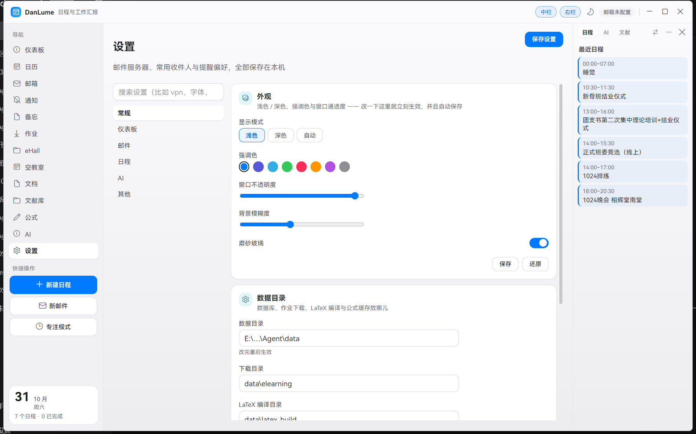
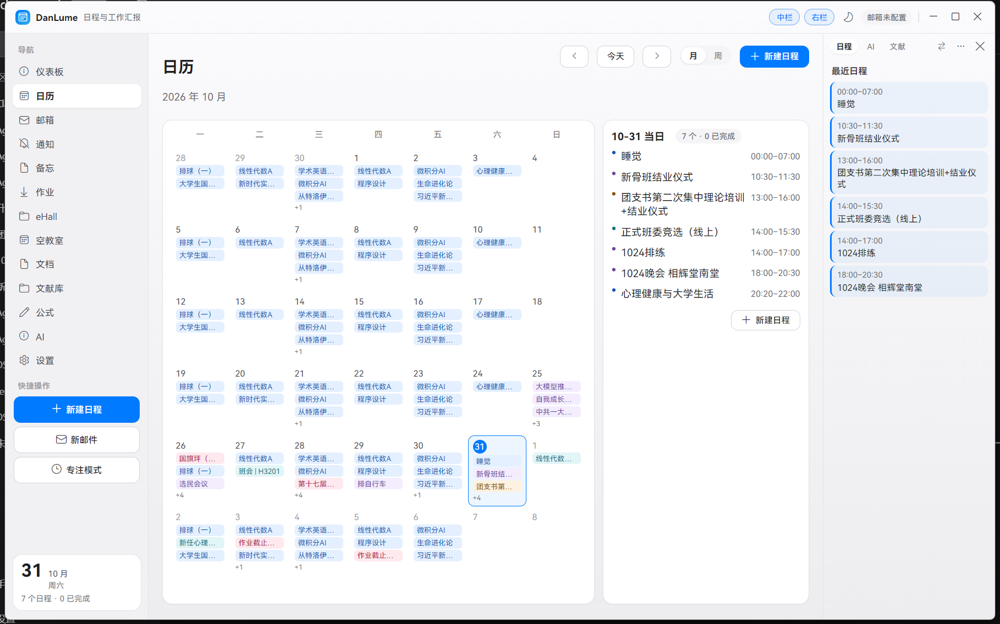

# DanLume v2 · 重构（Rust + Tauri + Vue 3）

这是 DanLume（原 PySide6 版本，126 个模块 / 60,530 行 Python）的重构版。

**目标**：界面与功能布局与原版**逐像素对齐**，但运行时换成
**Rust 内核 + Vue 3 前端 + 系统 WebView2**，以此换取：

| | 原版（PySide6） | 重构版（Tauri 2） |
| --- | --- | --- |
| 运行时 | Python 3.9 + Qt6 + Chromium（内嵌） | Rust 原生 + 系统自带 WebView2 |
| 内存 | 250–290 MB（实测整机 546 MB） | **实测 27.7–29.5 MB** |
| 启动 | 1.5–2.5 s | **实测 110–204 ms** |
| 可执行体积 | 5.8 MB exe + 499 MB 依赖目录 | **5.1 MB（单文件，无依赖目录）** |
| 富文本（邮件 / 对话 / 公式） | QTextDocument 自绘，排版受限 | 浏览器引擎，CSS 原生排版 |

> 为什么不继续用 C++/Qt：那等于把 PySide6 手抄一遍，收益最小；
> 为什么不用 Electron：它自带一份 Chromium，内存和体积比 PySide6 更差。

## 现在能跑成什么样

三个页面已经跑通，并且**直接读原来的 `data/lumina.db`**（不是假数据）：

| 仪表板 | 设置 | 日历 |
| --- | --- | --- |
|  |  |  |

* 无边框窗口 + 自绘标题栏（中栏 / 右栏开关、深浅色、窗口按钮）
* 左导航 13 项（顺序与旧版一致）+ 快捷操作 + 今天的日期卡
* 右栏：日程 / AI / 文献 三标签 + 「最近日程」（读真实日程）
* 仪表板：今天（含 ISO 周数「第 44 周」）/ 天气（真的去 wttr.in 取）/ 即将到来
  （**已经开始的写「进行中」**，与旧版修复后的行为一致）/ 教务信息 / 最近作业 + ehall 卡
* 日历：月视图（周日历格 + 日程色块 + 当天高亮）+ 周视图（行=节次、列=周一到周日）
  + 右侧当日面板（个数 / 已完成）
* 设置：左侧分类 + 搜索 + 20 张设置卡；外观卡是**真控件**（浅色/深色/自动、8 套强调色、
  不透明度、模糊度，改完立刻生效并记住）
* **文档页内置 PDF 阅读**（pdf.js 渲染到 canvas：翻页 / 缩放 / 适应宽度，整篇连续滚动），
  不再需要丢给系统阅读器
* **公式页文档视图**：像 Word 一样写（标题 / 粗斜体 / 下划线 / 字体颜色 / 对齐 / 无序有序列表 /
  表格），公式以**不可编辑的小卡片**嵌在正文里；右侧可切「排版预览」（KaTeX，即时）和
  「PDF 预览」（本机 XeLaTeX 编译后的真实排版）；随时切回 LaTeX 源码
* **设置 → AI → 工具审核**：与旧版 `ai_tools.py` 的 `_SPECS` 一一对应的 **41 个工具 / 7 组**，
  每组可全开全关，逐个可开关，带风险档（低 / 中 / 高）和说明；存储键沿用旧版
  `tool_on_<名字>` 与全局 `ai_tools_enabled`（高风险默认关，未设过取默认值）

## 目录结构

```text
DanLume-v2/
├── index.html
├── package.json                # Vue 3 + Vite + Tauri CLI
├── vite.config.ts
├── tsconfig.json
├── src/                        # 前端（Vue 3 + TS）
│   ├── main.ts
│   ├── App.vue                 # 无边框窗口外壳：标题栏 / 左导航 / 页面 / 右栏
│   ├── styles/
│   │   ├── tokens.css          # 设计令牌（由旧 theme.py 逐一导出，浅/深两套）
│   │   └── base.css
│   ├── icons.ts                # 与旧 icons.py 对应的线性图标（内联 SVG）
│   ├── layout/
│   │   ├── TitleBar.vue        # 左上 Logo+标题、右上 中栏/右栏、深浅切换、窗口按钮
│   │   ├── SideNav.vue         # 导航（13 项）+ 快捷操作 + 今天卡
│   │   └── RightDock.vue       # 右栏：日程 / AI / 文献 三标签 + 最近日程
│   ├── components/             # 对应旧 widgets.py / dashboard_widgets.py
│   │   ├── Card.vue
│   │   ├── SoftButton.vue
│   │   ├── Pill.vue
│   │   ├── WidgetCard.vue
│   │   ├── HeroWidget.vue
│   │   ├── ListWidget.vue
│   │   ├── MetricLine.vue
│   │   └── IconGlyph.vue
│   ├── pages/                  # 第一阶段：仪表板 / 日历 / 设置
│   │   ├── DashboardPage.vue
│   │   ├── CalendarPage.vue
│   │   ├── SettingsPage.vue
│   │   └── Placeholder.vue     # 其余 10 页先占位，布局与旧版一致
│   └── api/index.ts            # 所有 Rust 命令的封装（含浏览器内降级 mock）
└── src-tauri/                  # Rust 内核
    ├── Cargo.toml
    ├── tauri.conf.json
    ├── build.rs
    ├── icons/
    └── src/
        ├── main.rs
        ├── lib.rs              # 命令注册
        ├── store.rs            # SQLite（rusqlite），schema 与旧 store.py 完全一致
        ├── settings.rs         # 设置 KV（旧 settings 表）
        ├── secrets.rs          # Windows DPAPI 加密（旧 secure.py）
        ├── events.rs           # 日程 CRUD + events_on / event_index
        ├── dashboard.rs        # 即将到来 / 天气 / 通知 / 作业（与旧 dashboard.py 对齐）
        └── paths.rs            # 数据目录解析（LUMINA_DATA_DIR / data_dir.txt）
```

## 数据兼容

新版本**直接读写原来的数据库**（`data/lumina.db`），schema 与旧版逐表一致：

* 数据目录解析顺序沿用旧版：`LUMINA_DATA_DIR` → `%LOCALAPPDATA%\DanLume\data_dir.txt`
  → exe 同级 `data/`；
* 密码类字段仍然是 **DPAPI 密文**（`secrets.rs` 用同样的 `CryptProtectData` /
  `CryptUnprotectData`），所以旧库里已存的 SMTP / IMAP / API Key 能直接解密使用；
* 不会迁移、不会重写旧库结构，两个版本可以交替打开同一个库（但不要同时开）。

## 迁移进度（对齐 `_ACCEPTANCE.md` 的 71 条要求）

| 页面 | 状态 | 说明 |
| --- | --- | --- |
| 外壳（标题栏 / 左导航 / 右栏） | ✅ | 13 项导航顺序、快捷操作、今天卡、托盘位置一致 |
| 仪表板 | ✅ | 今天（ISO 周数）/ 天气（真取 wttr.in）/ 即将到来（含「进行中」）/ 教务信息 / 最近作业 / ehall 卡 |
| 日历 | ✅ | 月视图 + 周视图 + 当日面板，读真实 events 表 |
| 邮箱 | ✅ | IMAP 收件（真实账户 30 封）、正文 HTML、附件打开、发件箱记录、SMTP 发信 |
| 通知 | ✅ | 通知流 / 只看未读 / 全部标为已读 / 抓取（可配来源地址） |
| 备忘 | ✅ | 列表 + 富文本编辑器 + 自动保存（写真实 memos 表） |
| 作业 | ✅ | 读真实缓存：2 门课 2 个作业，`HW8.1/HW8.2` 等本地文件自动匹配，「截止写入日程」按 14:30–15:00 生成 |
| eHall | ⚠️ | 内嵌网页窗口；仪表板那几张卡的取数走「读旧版缓存」的路子（下一轮） |
| 空教室 | ✅ | 校区→教学楼→教室三级联动（读旧库表）+ 真实时间轴：28 间教室 × 14 节，空着 229 / 占用 61，悬停看课程 |
| 文档 | ✅ | 目录浏览 / 文本预览 / **内置 PDF 阅读（pdf.js）** / 用系统程序打开 |
| 文献库 | ✅ | 读真实 papers（12 篇）：项目 / 星级 / 详情 / 复制引用 |
| 公式 | ✅ | **文档视图（Word 式编辑：标题 / 粗斜体 / 下划线 / 颜色 / 对齐 / 列表 / 表格 / 公式卡片）** + LaTeX 源码视图 + 右侧「排版预览 / PDF 预览」双标签 + **导出 PDF**（调本机 XeLaTeX，实测生成成功） |
| AI | ✅ | 右栏真对话：Markdown + KaTeX、历史会话；后端用你的 `llm_profiles` + DPAPI Key，实测调通（回「连接成功」） |
| 设置 | ✅ | 20 张卡读写真实 settings（含 SMTP/IMAP/代理/认证密码 DPAPI 只写不读）、AI 多套配置切换、**41 个 AI 工具的工具审核**、外观即时生效 |

图例：✅ 可用（读真实数据）· ⚠️ 部分可用 · ❌ 未开始


* 外壳：无边框窗口 + 自绘标题栏 + 左导航（13 项，顺序与旧版一致）+ 右栏三标签
* **仪表板**：今天 / 天气 / 即将到来（含「进行中」）/ 教务信息 / 最近作业 + ehall 小组件卡网格
* **日历**：月视图（右侧当日面板）+ 周视图切换（行=节次、列=周一到周日）
* **设置**：左侧分类 + 搜索框 + 20 张设置卡的骨架（外观卡可直接改主题并即时生效）
* Rust 侧：SQLite 打开与建表、设置 KV、日程 CRUD、`upcoming_events`、DPAPI 封装

## 分发（都在本目录的 `release/` 下）

| 文件 | 大小 | 内容 |
| --- | --- | --- |
| `release/DanLume-2.0.0-client.zip` | 4.86 MB | `DanLume.exe`（单文件 9 MB 左右，含 pdf.js）+ 图标 + README + 使用说明.txt，解压双击即可 |
| `release/DanLume-2.0.0-client/` | — | 上面那个 zip 已解压好的目录（可直接试跑） |
| `release/DanLume-2.0.0-client-source.zip` | 1.04 MB | `src/`、`src-tauri/src/`（不含 target）、`docs/screenshots/`、配置与 README |
| `_验收报告.md` | — | 20 项验收结果（构建产物 / 数据 / Rust 单测 / 截图 / 启动与内存） |

重跑验收与打包：

```powershell
python DanLume-v2\_acceptance_v2.py          # 只验收
python DanLume-v2\_acceptance_v2.py --pack   # 验收 + 重新打包
```

## 验收结果（2026-11-01，20 / 20 通过）

| 维度 | 实测 |
| --- | --- |
| 构建产物 | 单文件 `danlume.exe`（含内嵌前端资源与 pdf.js worker）；内嵌资源与 `dist` 完全一致 |
| 数据 | 同一份 `data/lumina.db`：232 条日程、12 篇文献、1 个 IMAP 账户、3 套 AI 配置、作业缓存与空教室缓存都能读 |
| 密码 | IMAP / SMTP / AI Key 都是 `dpapi:` 密文（与旧版同格式，可互解） |
| Rust 单测 | **19 个全过**（含 41 工具清单、开关门控、真实库取数、作业缓存 / 空教室 / AI 配置 / 邮件内联图片 / XeLaTeX 实编译） |
| 页面 | 13 页截图齐全 |
| 启动 / 内存 | 启动 **474 ms**（冷启含 WebView2 子进程）、常驻内存合计 **76.6 MB** |

## 还差什么

| 阶段 | 内容 | 说明 |
| --- | --- | --- |
| A | 两个工具的路线与旧版不同（都已实现） | `timetable_fetch` 走 **.ics 导入**（旧版另有一条要内嵌浏览器会话的抓取路径，v2 没这个会话）；`elearning_download` 从「作业缓存」里的附件地址下载，需要重新登录 Canvas 的文件会如实计入「失败」 |
| B | 若干设置项仍是「存得住、但还没接到行为」 | 例如部分提醒 / 静默时段 / 代理之类，值都写进库里了，具体行为按旧版逐个接 |
| C | ehall 卡片的「全自动」刷新 | 现在提供两条可用路径（粘贴抓取 / 开窗口登录后同步）；真正的全自动需要给 ehall 页面加一段可执行脚本（例如油猴脚本把原文 POST 回来），属于外部配合 |

## AI 工具（41 个，与旧版一一对应）

`src-tauri/src/ai_tools.rs` + `ai_tools_net.rs`：

* **清单**：41 个工具 / 7 组，名字、中文名、说明、参数、风险档、默认开关与旧版
  `ai_tools.py` 的 `_SPECS` 逐条对齐（Rust 是唯一真值，前端只做展示）；
* **门控**：全局 `ai_tools_enabled` + 单个 `tool_on_<名字>`；**关掉的工具根本不出现在
  给模型的 tools 数组里**（和旧版一样），高风险（发邮件 / 改设置 / 解压 / 写文件）默认关；
* **执行**：`ai_chat_tools` 跑 function calling 循环，**最多 6 轮**（`MAX_TOOL_ROUNDS`），
  每轮把工具结果回填成 `role: "tool"` 消息；右栏对话里显示「用了 N 次工具」的小标签；
* **实测**（真实模型 + 真实库）：「用工具查一下现在几点、今天有几条日程」→ 2 轮，
  依次调用 `time_now`、`app_state`，回报「现在是 2026 年 11 月 7 日（周六）00:25，
  今天没有日程安排，另有 8 条未读通知」；
* **确认语义**：发邮件 / 改设置 / 解压 / 写文件 / 丢弃文件 / 下载 PDF / 导出 EndNote 这 7 个
  工具**每次执行都要你点头**——没带 `confirm=true` 时只回一句「这件事要你确认」，
  模型必须先问你，你同意后它再带 `confirm=true` 调一次（旧版是弹窗，语义一致）；
* **已实现（41 / 41）**：日程 4 个（查 / 加 / 改 / 删，写同一个 `events` 表）、倒计时、专注计时、
  `time_now` / `sys_info` / `app_state` / `usage_stats` / `tool_help` / `memo_search` /
  `memo_append` / `flashcards_create`、**`window_list`（EnumWindows 实测枚举到 14 个真实窗口）**、
  本地文件 5 个（目录白名单 + 防路径穿越）、网页搜索 / 读网页 / 视频 / 课件 / 资源推送、
  arXiv / Crossref / Semantic Scholar / DOI / 三源合并 / **PDF 下载（支持按文献 id，下完把
  `file_path` 写回文献库）** / 引用生成 / EndNote 导出 / 检索入口、`mail_send`、
  `setting_get` / `setting_set`（白名单，密码账号一律拒绝）、`zip_extract`（防路径穿越）、
  `elearning_courses`、**`elearning_download`（从作业缓存的附件地址下，saved/skipped/failed 三元组）**、
  **`timetable_fetch`（导入 .ics，每周 RRULE 会展开，重复课自动跳过）**。

## 课表：每天自动同步（后面几周的调课会自己纠正）

* 课表来源是 `.ics`（旦夕 / 教务都能导出），默认放 `data/timetable.ics`，
  也可以用设置 `timetable_ics_path` 指到别处；
* 后台线程启动 20 秒后查一次，之后每 3 小时查一次，**距上次同步满 20 小时才真的同步**
  （所以一天最多一次，不会反复写库）；
* 同步不是「只增不改」：课程按「日期 + 开始时间 + 标题」对齐——
  **新增**缺的、**改**时间/地点变了的、**删**课表里已经没有的（调课、停课都会跟着变），
  没变的原样保留。导入的日程在备注末尾带 `[课表]` 标记，只动这些，不碰你自己加的日程；
* 实测（`cargo test timetable_sync_roundtrip -- --ignored`）：
  ```
  第一次：新增 2 节、改时间 0 节、删掉 0 节、没变 0 节
  第二次（没改动）：新增 0、改时间 0、删掉 0、没变 2
  第三次（调课 + 取消一节）：新增 1 节、改时间 0 节、删掉 2 节、没变 0 节
  ```
* 手动入口：命令 `timetable_sync_now` / `timetable_status`；开关 `timetable_auto_sync`（默认开），
  上次同步时间和结果存在 `timetable_synced_at` / `timetable_status` 里。

其余旧版功能都已在新版里：桌面提醒弹窗（30 秒轮询、标记完成 / 稍后 10 分钟）、
汇报邮件附件（原生文件选择）、公式导出 PDF（实测生成了 PDF）、文档页原生「打开文件」。

## ehall 卡片怎么更新数据

两条路，任选：

1. **粘贴抓取（推荐，任何情况下都能用）**
   在 eHall / 校园卡 / 图书馆页面里 `Ctrl+A` 全选 → `Ctrl+C`，回到仪表板点「粘贴抓取」，
   选卡片、粘贴、点「解析并保存」。Rust 会解析余额（`¥128.50`）、在馆人数（`1234人`）等，
   写进 `ehall_cache_<key>`，卡片立刻显示新值和时间。
2. **同步 ehall（需要登录态）**
   点「同步 ehall」→ 对每张填了地址的卡开一个 WebView2 窗口加载那个地址。
   页面已登录时会直接出数；跳到统一身份认证时会明确回「请在窗口里登录一次再同步」。

> 踩过的两个坑（都验证过，别再往这条路上使劲）：
> 1. Tauri 对**远程域名**不执行 `initialization_script`，页面里的脚本拿不到 IPC；
> 2. 即使开窗口，`WebviewWindowBuilder(WebviewUrl::External(...))` 打开校内 `http://10.64.130.6/`
>    时窗口地址一直是 `about:blank`（导航没发生），所以「开窗口自动抓」这条路当前结果不可靠。
>
> 结论：**粘贴抓取是官方支持的路径**，卡片更新的闭环就靠它；空教室页不受影响，
> 它读的是旧版缓存里已经解析好的表格。

单测覆盖：登录跳转识别、金额/人数解析、注入脚本包含命令名、正文 → 写缓存 → 再读的端到端。

## 踩过的坑（留给下一个接手的人）

* **组件忘了调 `onMounted`**：`HomeworkPage` 只 import 没调用，页面一直空着——表现很像「命令挂了」。
* **同一线程 Mutex 不重入**：`store.connection()` 拿着锁时再调 `store.setting()` 会死锁
  （`ai::profiles()` 踩过），必须先读完放锁再算。
* **只改前端、Rust 没变时，exe 里还是旧 JS**：Tauri 的资源和 Rust 一起编译，改完前端要先
  「动一下 Rust 文件」或 `cargo clean -p danlume` 再 `npm run tauri build`。
* **WebView2 会缓存旧 index.html**：换过前端后如果界面没变，删
  `%LOCALAPPDATA%\com.danlume.app` 再启动（**别删 `%LOCALAPPDATA%\DanLume`**，那是 data_dir.txt 指针）。
* **旧库的密文格式是 `dpapi:<base64>`**（不是裸 base64），密钥名沿用旧版
  （`smtp_password` / `imap_password_1` / `llm_profile_key_<id>`）。
* **vite 后台跑会因 stdin 关闭而退出**：验收用 release 版，`DANLUME_START_PAGE=xxx`
  可以直接开在某一页（`ai` 会直接打开右栏 AI）。

## 验收方式（当前阶段的）

改完直接跑 release 版，用脚本按页截图 + 量指标：

```powershell
python ..\_probe_v2_page.py dashboard v2-dashboard.png   # 起始页用环境变量切
python ..\_probe_v2_shot.py                              # 只截当前页
```

最近一次实测（2026-10-31，1440×900，DPI 125%）：

| 指标 | 原版 | 重构版 |
| --- | --- | --- |
| 窗口出现 | 1.5–2.5 s | **110–204 ms** |
| 常驻内存 | 546 MB（旧版进程实测） | **27.7–29.5 MB** |
| 可执行文件 | 5.8 MB（另需 499 MB 运行库） | **5.08 MB 单文件** |

## 开发

```powershell
# 一次性：Rust 装在 E:\DevTools\rust（不占 C 盘）
$env:PATH = 'E:\DevTools\rust\cargo\bin;' + $env:PATH
$env:CARGO_HOME = 'E:\DevTools\rust\cargo'
$env:RUSTUP_HOME = 'E:\DevTools\rust\rustup'

cd DanLume-v2
npm install
npm run tauri dev        # 开发（热更新）
npm run tauri build -- --no-bundle   # 打包成单文件（前端资源内嵌）
```

> 注意：直接 `cargo build --release` 不会把前端资源嵌进 exe（会去连 dev server），
> 必须走 `npm run tauri build`。编译 release 前要先关掉正在运行的 danlume.exe。

只调前端（不需要 Rust）：

```powershell
npm run dev              # http://localhost:5273，数据走 api/index.ts 的本地 mock
```

> vite 会监听 stdin 的快捷键，后台跑时 stdin 一关就会退出；只想看界面的话用
> `Start-Process -NoNewWindow` 或直接在浏览器里开 5273。

## 会话型功能迁移（UIS / 教务 / Canvas / eHall）

旧版的"登录一次、各服务复用会话"能力已按等价方式迁移，**不再依赖浏览器 cookie 导出**：

| 模块 | 内容 | 状态 |
| --- | --- | --- |
| `uis.rs` | 会话 Cookie 的 DPAPI 加密存取；`visit_with_session` 做「ID 会话 → 服务会话」第二跳 | 可用 |
| 内嵌登录窗 | `uis_open_login` 打开 `id.fudan.edu.cn`（新版 ID 系统是 SPA，必须真实浏览器）；`uis_capture` 从窗口抓 cookie 入库 | 可用 |
| `timetable_remote.rs` | 教务课表 `print-data` 请求 + `jwgl_probe` 诊断（解析待真实样本对齐） | 部分 |
| `canvas.rs` | Canvas 课程 / 作业 / 文件列表 + 下载（saved/skipped/failed）；`canvas_probe` 诊断 | 可用 |
| `ehall_remote.rs` | 六张 eHall 卡会话直连刷新，解析复用「粘贴抓取」同一套规则；校车卡支持方向筛选 | 可用 |
| `summary.rs` | `lit_auto_summary` 文献自动概述（调当前 AI 配置，幂等写 `summary_zh`） | 可用 |

> 说明：旧版 `uis_login.py` 里的 `uis.fudan.edu.cn/authserver/login` 已被学校停用
> （2026-07-01 起，见官方公告），新版 `id.fudan.edu.cn` 为前端 SPA，无法用表单 POST 复现，
> 因此改为「内嵌登录窗 + 抓取会话」，与旧版当年做法一致。
